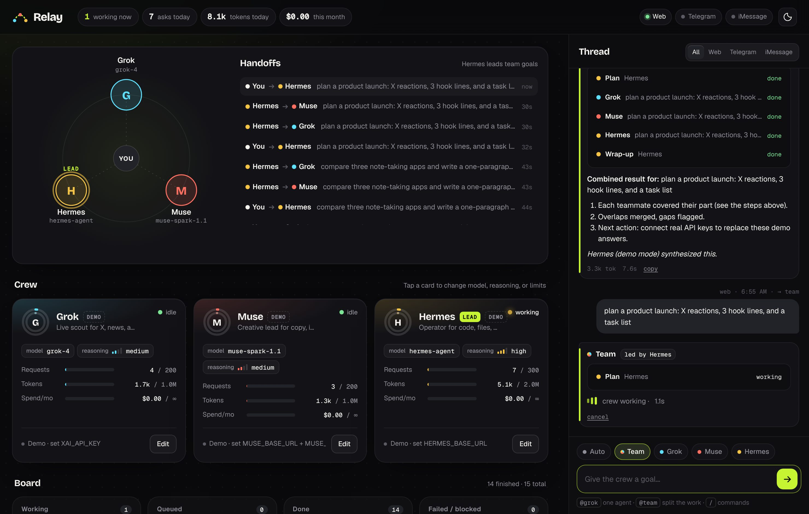

# Relay

One place to run all your AI agents together. Talk to Grok, Muse, and Hermes from one dashboard, Telegram, or iMessage. Give the crew a goal and the lead agent splits it, delegates in parallel, and hands back one answer.

[](./LICENSE)
[](https://github.com/TonkaToyXL/agent-loop-runner/actions/workflows/ci.yml)
[](./package.json)



## What it does

- **One thread for every agent.** `@grok`, `@muse`, `@hermes`, or plain text (Relay picks the best agent from its strengths).
- **Team mode.** `@team <goal>`: the lead plans, subtasks run in parallel, the lead writes the wrap-up. Watch the baton move on the crew map.
- **Limits that reroute.** Daily request/token caps and a monthly budget per agent. When one agent is capped, auto-routed and team work moves to a teammate; direct asks stop and say why.
- **Model and reasoning labels everywhere**, editable from the dashboard or by chat (`/model grok grok-4-fast-reasoning`, `/reasoning hermes high`).
- **Dashboard:** who's working, board of queued/working/done/failed, leaderboard of who did the most work, tokens, spend, and provider rate-limit headroom when the provider reports it.
- **Phone control** through Telegram and iMessage, with allowlists.
- **Works before you add keys.** Agents without keys run in a labeled demo mode so you can try the whole flow first.

## Set up on a Mac (one command)

On an always-on Mac such as a Mac mini:

```bash
git clone https://github.com/TonkaToyXL/agent-loop-runner.git ~/agent-loop-runner
cd ~/agent-loop-runner
npm run setup:mac
```

It installs what Relay needs, connects the agents you already use, links Telegram, blocks pay-per-use APIs, and keeps Relay running in the background (it starts at login and restarts if it stops). Run it again any time to add something. Each piece also has its own command: `npm run setup:hermes`, `setup:grok`, `setup:telegram`.

To try it without connecting anything: `npm install && npm run hub`, then open http://127.0.0.1:4747. Unconnected agents answer in a labeled demo mode and never join real team work.

## No surprise bills

Relay uses the subscriptions and tools you already have. Pay-per-use APIs are **blocked by default**, even if a key is in `.env`; set `RELAY_ALLOW_METERED=true` only if you want them. Every agent card shows how it's paid for.

| Agent | How Relay reaches it | Cost |
|---|---|---|
| **Grok** | A Grok Bot routine with a Webhook trigger | Your Grok subscription (Grok Bot usage) |
| **Hermes** | Hermes Agent's built-in API server on your Mac | Whatever Hermes already uses |
| **Claude** | Claude Code signed in on your Mac (`claude -p`) | Your Claude plan |
| **Muse** | Meta's Model API | Pay-per-use, so **off** by default. The Muse app can't be controlled by other apps. |
| Grok via xAI API | Optional fallback | Pay-per-use, blocked by default |

Agents are defined in [`relay.config.json`](./relay.config.json). Any OpenAI-compatible endpoint (Ollama, LM Studio, OpenRouter) or local command-line assistant can be added as another entry. Mark each connection's `billing` as `subscription`, `local`, or `metered`.

## Connect your agents

**Hermes Agent.** On the computer that runs Hermes, from this folder:

```bash
npm run setup:hermes
```

It turns on Hermes' API server with a random key (backing up `~/.hermes/.env` first), copies the key into Relay's `.env` without printing it, offers to restart the Hermes gateway, and checks that Hermes accepts the key. Safe to run again. To do it by hand instead: put `API_SERVER_ENABLED=true` and `API_SERVER_KEY=<long random string>` in `~/.hermes/.env`, restart `hermes gateway`, and set `HERMES_BASE_URL=http://127.0.0.1:8642/v1` and the same key as `HERMES_API_KEY` in Relay's `.env`.

Once connected, Hermes' card shows online/offline, the reasoning level is sent with each request, and each reply shows the model that actually answered. Hermes uses its own default model unless you set a **Provider** in its editor (for example `openrouter`); then the Model field picks the exact model Hermes runs.

**Muse.** Relay can only reach Muse Spark through Meta's pay-per-use Model API, so Muse stays off unless you set `MUSE_BASE_URL`, `MUSE_API_KEY`, and `RELAY_ALLOW_METERED=true`. Relay can't drive the Muse phone app.

**Grok Bot.** `npm run setup:grok` walks you through it: create a new Grok Bot routine named Relay with a Webhook trigger, paste the instructions it prints (also copied to your clipboard), then paste the routine's webhook URL, key, and key header. The routine answers by running `scripts/relay-reply.sh`, which only ever posts to Relay's own callback address. The routine's computer must be the Mac running Relay, or set `RELAY_PUBLIC_URL` to an address it can reach.

**Claude.** If Claude Code is installed and signed in (`claude` once in Terminal), Claude joins the crew automatically and runs on your Claude plan. Pick `sonnet`, `opus`, or `haiku` in its editor.

**Other agents.** Add an entry to `relay.config.json` with an `openai` connector (any OpenAI-compatible URL) or a `cli` connector (a local command that takes the prompt on stdin). Set `reasoningParam: "reasoning_effort"` on an `openai` connector only if that model accepts it.

## Telegram

Free. Run `npm run setup:telegram` (or let `setup:mac` do it):

1. In Telegram, message [@BotFather](https://t.me/BotFather), send `/newbot`, and paste the token when asked.
2. Send your new bot any message while the script waits. It allowlists that chat automatically. Anyone else gets refused.

Uses long polling, so no public URL is needed.

## iMessage

iMessage needs a Mac signed in to Messages, running [BlueBubbles Server](https://bluebubbles.app). A separate Apple ID for the bot is cleanest.

1. In `.env`: `BLUEBUBBLES_URL`, `BLUEBUBBLES_PASSWORD`, `IMESSAGE_ALLOWED_HANDLES` (your number or email), and a long random `IMESSAGE_HOOK_TOKEN`.
2. In BlueBubbles, add a webhook for **New Messages** pointing to `http://127.0.0.1:4747/hooks/imessage?token=<IMESSAGE_HOOK_TOKEN>` (use `RELAY_PUBLIC_URL` instead of 127.0.0.1 if the hub runs elsewhere).
3. Text the bot's Apple ID from your phone.

Relay ignores messages from non-allowlisted handles and its own sent messages, so replies never loop.

## Chat commands

Same everywhere: dashboard, Telegram, iMessage.

```text
@grok <ask>       talk to one agent
@team <goal>      lead plans, crew splits the work
<plain text>      auto-picks the best agent
/agents           models, reasoning, usage
/status           what's running now
/board            who did the most work
/model <agent> <model-id>
/reasoning <agent> off|low|medium|high|max
/lead <agent>     choose who plans team goals
```

## Use the dashboard from your phone

Telegram is the easiest way to use Relay from your phone. For the full dashboard on your phone, install Tailscale (free for personal use) on the Mac and phone and say yes to the phone-dashboard step in `npm run setup:mac`. It sets `HOST=0.0.0.0` and a password (`HUB_TOKEN`). The hub refuses to listen beyond localhost without one. The dashboard installs as a home-screen app.

## Data

State (tasks, usage, your model/limit edits) lives in `~/.local/share/agent-relay/hub/state.json`. Override with `RELAY_STATE`. Keys are never written there.

## PR Babysit

This repo also ships the original CLI that loops a Cursor agent on an open PR until CI is green and review threads are resolved.

```bash
export CURSOR_API_KEY="your-key"
npm run babysit-pr -- --repo owner/repo --pr-number 42 --cwd /path/to/clone
```

| Flag | Description |
|------|-------------|
| `--repo` | GitHub repo `owner/name` (required) |
| `--pr-number` / `--pr` | PR number (required) |
| `--cwd` | Local clone path (default: cwd) |

Exit codes: `0` merge-ready, `2` merge conflicts, `3` agent run did not finish, `4` max iterations reached. Logs go to `~/.local/share/agent-relay/pr-babysit/<owner>__<repo>/pr-<number>.jsonl`. Requires `gh` authenticated for the target repo.

## Requirements

- Node.js 22.13+
- No extra runtime dependencies for the hub

## License

MIT
